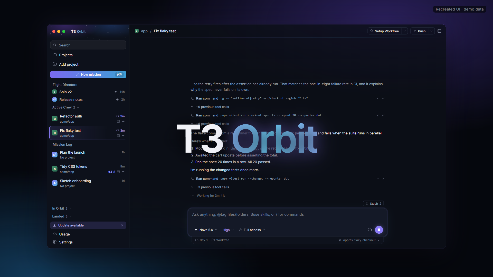
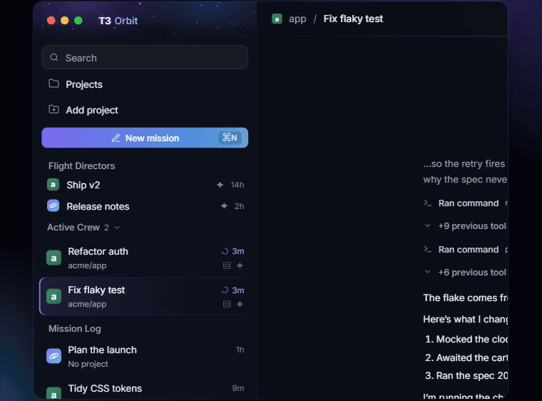
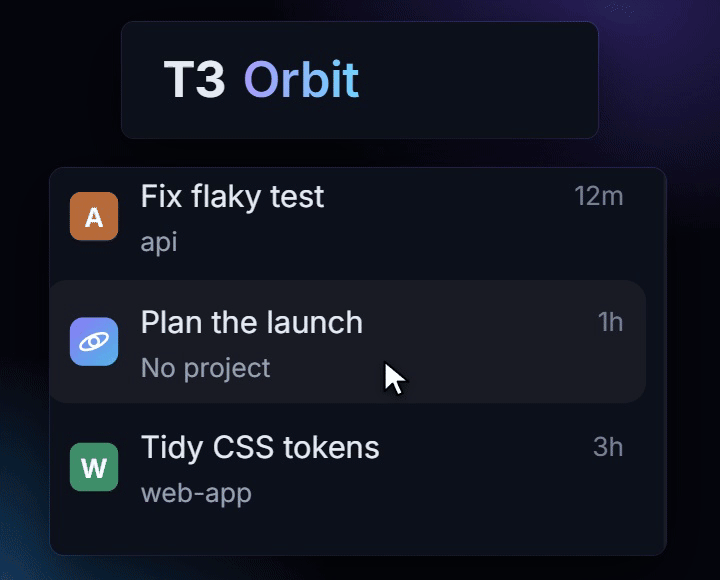
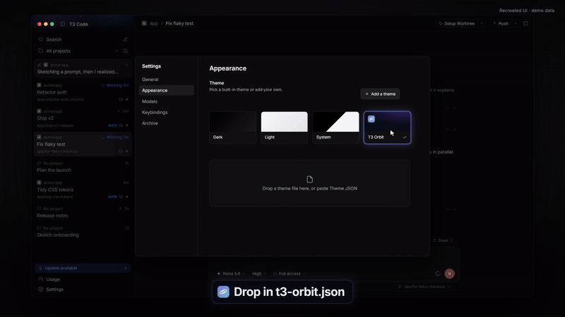
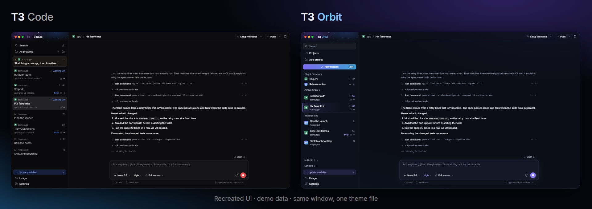

# T3 Orbit

A dark, space-themed theme for [T3 Code](https://github.com/pingdotgg/t3code). It has deep navy surfaces, a violet-to-cyan accent and a little orbit.

T3 Orbit is a fork of [T3 Clawd](https://github.com/rohit3a/t3-clawd) by [@rohit3a](https://x.com/rohit3a). It keeps Clawd's layout work and swaps the look for a nightly, deep-space one. It's one theme file: no app fork and no source changes. Version 2 uses about 22k of T3 Code's 50,000-character CSS limit.

## What changes

- Deep-space palette: near-black navy surfaces, a violet accent and a soft nebula glow behind the chat
- **New in v2:** a slow-drifting, twinkling starfield behind the chat
- **New in v2:** a rotating violet-to-cyan border on the composer while you type, a breathing send button, and new messages that fade up into place
- **New in v2:** smoother hover states, menus that ease in, and a New mission gradient that slides on hover
- **New in v2:** a light mode (soft white with the same violet)
- **Pinned chats are back on top** as Flight Directors
- Space crew names: Flight Directors (pinned), Active Crew, In Orbit, Landed, Mission Log, New mission
- Compact Flight Directors rows: icon, title, model logo and time
- Chats without a project get a small violet orbit icon, which spins on hover
- A slowly shimmering gradient "T3 Orbit" wordmark and a violet bar on the current chat
- T3 Code's own chat typography: message text, bubbles and code blocks are untouched
- More of the look uses T3 Code's built-in color roles, so it holds up better across updates
- All motion stops when Reduce Motion is on

Clawd's layout work is unchanged: the sidebar menu, the two-line chat rows, the model picker and the effort bar.

## Install

1. Download [`t3-orbit.json`](https://raw.githubusercontent.com/CollinCraig/t3-orbit/main/t3-orbit.json).
2. In T3 Code, open **Settings → Appearance** and click **Add a theme**.
3. Drop the file in (or paste its contents into **Theme JSON**), then pick **T3 Orbit**.

## Preview

| Sidebar | Orbit on hover | Theme morph |
| --- | --- | --- |
|  |  |  |

**Before and after**

▶ **[Watch the launch film](media/t3-orbit-film.mp4)** (29 s, with sound). Every frame was rendered from HTML with [Remotion](https://www.remotion.dev), and the music is an original score synthesized in code. The source is in [`film/`](film/). There's also a [square cut](media/x-post.mp4).

## Notes

- Built on T3 Code Nightly (November 2026). Themes style the app through its internal attributes, so a T3 Code update may break a piece or two. If something looks off, open an issue.
- The previews and the film recreate T3 Code's UI with demo data. They aren't screen recordings.
- Unofficial. Not affiliated with T3.

## Credits and license

MIT. The original theme is [T3 Clawd](https://github.com/rohit3a/t3-clawd) by [@rohit3a](https://x.com/rohit3a); T3 Orbit's changes are by [Collin Craig](https://x.com/CollinCraigAI). Inter, used in the film, is under the SIL Open Font License 1.1.
